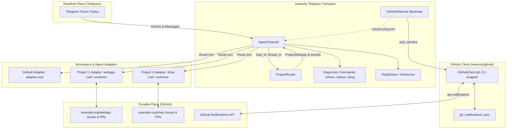

# Swarmly Architecture

This document describes the component relationships, data flow, and architectural principles of Swarmly.

## 1. Architectural Principles

- **Separation of Planes**:
  - **Realtime / Instant Plane**: Telegram forum topics provide low-latency communication, notifications, and human oversight.
  - **Durable Plane**: GitHub issues/PRs (and optionally signed envelopes on gitbus / folder / gdrive) act as the persistent coordination platform.
  - **Fast Plane** (optional): Local TCP gateway for fast LAN agent-to-agent communication.
- **Topic-to-Project Binding**:
  - Discussions in Telegram forum topics map directly to individual project repositories.
  - Topics are bound strictly by **numeric topic ID** (`int` for home channel or `chat_id/thread_id` for external groups), never by display name.
- **Workspace Isolation**:
  - Each bound project has a dedicated working directory (`cwd`).
  - When `worktrees: true` is enabled, topics create isolated git worktrees (`.swarmly-worktrees/topic-<thread_id>`) to avoid race conditions and cross-topic workspace pollution.
  - State files (sessions, history) are segregated per project and per thread.
- **GitHub Backstop (Missed-Ping Resilience)**:
  - When realtime Telegram delivery succeeds, turns run immediately and notifications are deduplicated and skipped silently.
  - If a Telegram message is dropped or offline, the background GitHub watcher catches up unread notifications (mentions, reviews, assignments) and triggers the turn.
- **Strict Attribution**:
  - Every agent operates and commits under its own identity (`agent@a2a.local`).
- **Acting Coordinator & Bus Leases**:
  - An append-only coordinator lease (`.agents/leases/<term>-<alias>-<nonce>.json`) on the durable bus determines the coordinator dynamically.
  - Succession order defaults to `reviewer` -> `qa-tester` -> `developer`, yielding when superseded by higher terms or admin `/role`.
  - **Old-Release & Clock Validation (#126 Item 3)**: Claims stamped with implausible timestamps (< 2020 or > 1 day in the future) are rejected as old releases using host uptime clocks instead of wall clock. Rejected aliases are logged once and reported in `/status` and `/swarm`.
  - **Configured Coordinator Failback (#126 Item 4)**: When the configured/named coordinator has been UP and idle for a configurable window (`limits.coordinator_reclaim_idle_seconds`, default 180s) while a successor holds a live lease, it claims term N+1 (`promoted=True`) and announces the reclaim once.
  - Durable round state writes require coordinator authority and term fencing (`Authority(alias, source="lease", term)`), preventing split-brain updates and stale overwrites.
- **Human-in-the-Loop & Override**:
  - A human operator has visibility and control over all agent turns and can intervene in Telegram at any time.

---

## 2. Component Diagram



---

## 3. Data Flow

### 3.1 Inbound Message & Project Routing

1. An incoming Telegram message arrives at `AgentChannel.handle_message`.
2. The topic ID (`message_thread_id`) and `chat_id` are passed to `ProjectRouter.project_for(chat_id, thread_id)`.
3. If the topic is bound:
   - `ProjectRouter.workdir_for(project, thread_id)` resolves the working directory:
     - If `worktrees: false`: returns `project.cwd`.
     - If `worktrees: true`: ensures a clean detached git worktree at `<cwd>/.swarmly-worktrees/topic-<thread_id>` (with `.swarmly-worktrees/` excluded in `.git/info/exclude`), falling back gracefully to `project.cwd` if git fails.
   - `AgentChannel._adapter_for(chat_id, thread_id)` obtains or creates an `AgentAdapter` for that specific workdir path with isolated session files (`<alias>_sessions-<project>[-t<thread>].json`).
   - The prompt framing injects `- Project: <key> (github.com/<repo>)` into the turn instructions.
4. If the topic is unbound or General:
   - The default `adapter.cwd` and default `self.adapter` are used.

### 3.2 GitHub Backstop & Notifications Polling

1. `GitHubWatcher` runs periodically every `github.poll_minutes` (when > 0) or manually via `swarmly-telegram gh-poll --once`.
2. For each configured project repo, it checks unread notifications for `github.login`.
3. For each notification:
   - If already recorded in `gh_notifications-<alias>.json`, it is skipped.
   - If `AgentChannel.has_recent_ref(...)` detects that the issue/PR was already handled in recent turns in that project's topic, it marks the notification as processed (and optionally read via `gh api -X PATCH /notifications/threads/<id>`), skipping turn execution silently.
   - If missed in Telegram, it formats a backstop turn:
     - Mention: `GitHub notification: <user> mentioned you on <repo>#<number>: <snippet>`
     - Review request: `GitHub review requested on <repo>#<number> by <user>`
     - Assignment: `GitHub assignment: <repo>#<number> by <user>`
   - Dispatches the turn into the bound topic (or General) in the project workspace, and records the notification ID in `gh_notifications-<alias>.json`.

### 3.3 Commands & Diagnostics

- `/where`: Responds directly in the topic with the numeric topic ID, chat ID, and bound project metadata (`project=<key> repo=<repo> workdir=<path>`) or indicates Telegram-only unbound status.
- `/status`: Reports system health, active adapters, bound project, and GitHub backstop state (`github: @<login> (backstop: <m>m, last: <ts>)` or `github: disabled`).
- `swarmly-telegram gh-poll --once`: Executes one backstop poll cycle directly from the CLI.

---

## 4. Configuration Schema

```yaml
agent:
  name: example_bot
  alias: Antigravity
  home_channel_id: -1001234567890

projects:
  webapp:
    repo: example-org/webapp
    cwd: ~/projects/webapp
    topics: [12, 15]
    worktrees: true
  shop:
    repo: example-org/shop
    cwd: ~/projects/shop
    topics: [21]

github:
  login: swarmly-antigravity-bot   # agent's GitHub identity (required when projects configured)
  token_env: GH_TOKEN_ANTIGRAVITY  # env var holding GitHub token (default GH_TOKEN)
  poll_minutes: 5                  # poll interval in minutes (0 disables backstop)
  mark_read: true                  # mark processed notifications read on GitHub
```

For complete user-facing documentation, migration instructions, and troubleshooting, see [docs/PROJECTS.md](docs/PROJECTS.md).
